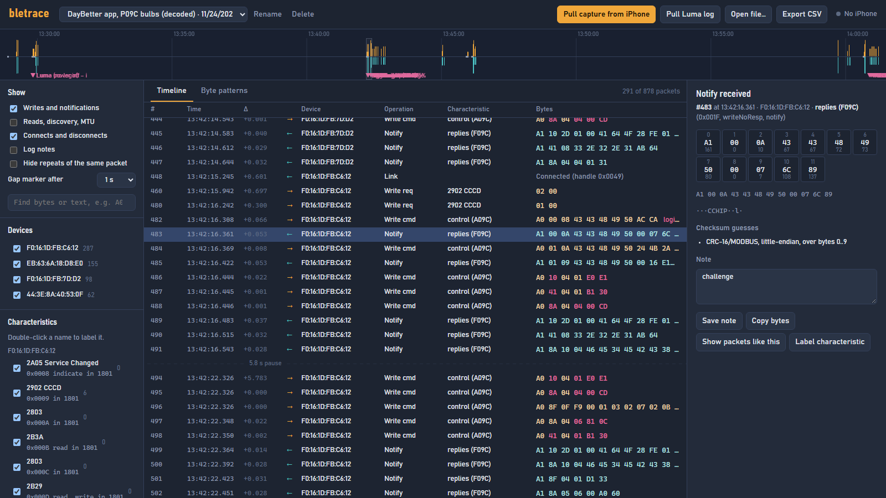
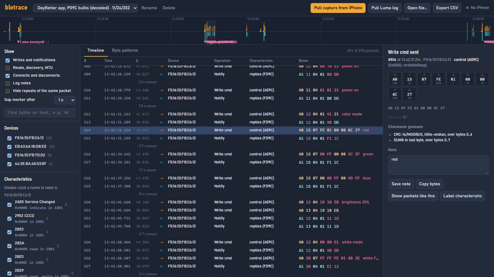
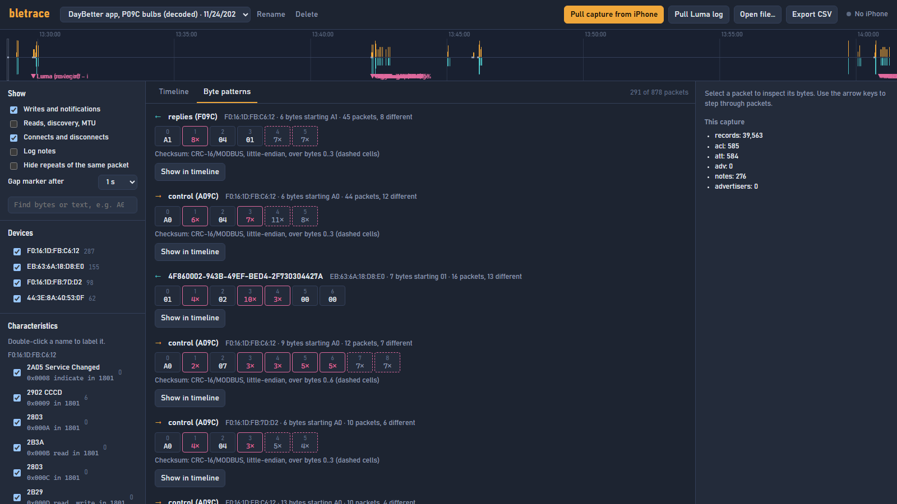

# bletrace

A workbench for reverse-engineering Bluetooth LE gadgets. It pulls a Bluetooth packet capture
off your iPhone over USB, decodes it down to the bytes each app writes, and shows them in a
browser GUI built for spotting patterns. Python standard library only, no installs.

## Start

```bash
cd /mnt/c/Users/maxwa/Documents/__projects/bletrace
./bletrace.sh gui          # opens http://localhost:8765 in your Windows browser
```

Run it in **WSL**. To pull captures, the iPhone must be attached to WSL (`usbipd.exe attach --wsl --busid <BUSID>`
then `sudo usbmuxd`; see `../xtool-commands.txt`). The dot in the top-right corner turns teal when it's connected.

## Capturing an app (iPhone)

1. Install Apple's **Bluetooth** logging profile on the phone (developer.apple.com/bug-reporting/profiles-and-logs),
   then restart the phone.
2. Close other apps that use the device. In the vendor app, do one action at a time, a few seconds apart,
   and write down the order (off, on, red, green, blue, bright, dim…).
3. Hold **both volume buttons + side button** about 1 s, until the phone vibrates. Wait 5 to 10 minutes.
4. In the GUI, choose **Pull capture from iPhone** (or run `./bletrace.sh pull`).

It also opens `.pklg` files from macOS PacketLogger and Android `btsnoop_hci.log` files (**Open file…**).
**Pull Luma log** imports LumaRemote's own `diagnostics.txt`, so you can compare what Luma sends with what the vendor app sends.

## Reading a capture

- **Trace strip** (top): every packet over time. Amber lines rising = the phone sent; teal lines hanging = the phone received.
  Each of your taps shows up as a burst; click one to jump to it. Notes appear as magenta flags.
- **Timeline**: magenta bytes changed since the previous packet of the same shape on the same
  characteristic. Dotted "pause" rows mark gaps, which line up with your taps.
- **Detail** (right): byte grid with decimal values, checksum guesses, and a note box. Note each burst
  with what you did ("tapped red"); notes are saved with the capture.
- **Byte patterns**: groups packets by characteristic, length and first byte. Magenta cells vary,
  plain cells are constant, dashed cells are the detected checksum.
- Double-click a characteristic in the sidebar to name it.

## Example: DayBetter P09C bulbs

bletrace was built to work out the protocol of DayBetter P09C Bluetooth bulbs for
[LumaRemote](../LumaRemote/README.md), a replacement iOS app. Luma's commands were being silently ignored, so
the official app was captured doing one action every ~3 s (off, on, red, green, blue, dim, white), then
each burst was labeled in the GUI.



The timeline showed the official app doing one thing Luma didn't: a `"CCHIP"` login before any command.
The bulb replies with 2 random challenge bytes, and the app answers with **challenge XOR `24 4C`**.
Labeling each burst made the rest easy to read:



**Byte patterns** showed which positions vary and found the checksum (CRC-16/MODBUS, little-endian) without being told:



### CCHIP login

The bulb ignores every command until the connection has logged in. `"CCHIP"` (`43 43 48 49 50` in ASCII)
is a fixed tag that every login frame carries. No idea what it means. The login is a
challenge-response handshake: the bulb sends 2 random bytes, and the app proves it knows the shared key
`24 4C` by sending them back XORed with it. The key never changes, so any app that knows it can log in.

Here is one login from the capture:

1. **Hello.** The app writes `A0 00 08 43 43 48 49 50 AC CA` (cmd `00` plus `"CCHIP"`).
2. **Challenge.** The bulb notifies `A1 00 0A 43 43 48 49 50 06 03 6E EA`. The challenge is `06 03`.
3. **Answer.** The app XORs the challenge with the key, byte by byte:
   `06 ^ 24 = 22` and `03 ^ 4C = 4F`. It then writes `A0 01 0A 43 43 48 49 50 22 4F 28 4A`.
4. **Accepted.** The bulb notifies `A1 01 09 43 43 48 49 50 00 16 E1`. The `00` after `"CCHIP"` appears to mean success.
5. Commands work from here on. The app sends a status request straight away.

The challenge is new on every connection. A second bulb in the same capture sent `00 07`, and the app
answered `24 4B`.

### What the bytes mean

Every frame is `A0 cmd len payload… crcLo crcHi`, written to `A09C`. Replies are `A1 cmd …` on `F09C`.

| Full frame (from the capture) | Header | Cmd | Len | Payload | CRC | Meaning |
|---|---|---|---|---|---|---|
| `A0 00 08 43 43 48 49 50 AC CA` | `A0` sent | `00` login hello | `08` | `43 43 48 49 50` = `"CCHIP"` | `AC CA` | Starts the login |
| `A1 00 0A 43 43 48 49 50 06 03 6E EA` | `A1` reply | `00` login hello | `0A` | `"CCHIP"`, then `06 03` = challenge | `6E EA` | Bulb's random challenge |
| `A0 01 0A 43 43 48 49 50 22 4F 28 4A` | `A0` sent | `01` login answer | `0A` | `"CCHIP"`, then `22 4F` = challenge XOR `24 4C` | `28 4A` | Answers the challenge |
| `A1 01 09 43 43 48 49 50 00 16 E1` | `A1` reply | `01` login answer | `09` | `"CCHIP"`, then `00` = OK | `16 E1` | Login accepted |
| `A0 10 04 01 E0 E1` | `A0` sent | `10` status | `04` | `01` | `E0 E1` | Status request (45-byte reply) |
| `A0 11 04 00 70 E1` | `A0` sent | `11` power | `04` | `00` = off | `70 E1` | Power off |
| `A0 11 04 01 B1 21` | `A0` sent | `11` power | `04` | `01` = on | `B1 21` | Power on |
| `A0 12 04 01 41 21` | `A0` sent | `12` mode | `04` | `01` = color (`00` = white) | `41 21` | Color mode |
| `A0 15 07 FE 01 00 00 6C 27` | `A0` sent | `15` color | `07` | `FE 01 00` = R G B, then `00` = unknown | `6C 27` | Red (where the color wheel landed) |
| `A0 15 07 00 FF 00 00 3C 3F` | `A0` sent | `15` color | `07` | `00 FF 00` = R G B, then `00` | `3C 3F` | Green |
| `A0 15 07 00 00 FF 00 4D FF` | `A0` sent | `15` color | `07` | `00 00 FF` = R G B, then `00` | `4D FF` | Blue |
| `A0 13 04 19 10 EB` | `A0` sent | `13` brightness | `04` | `19` = 25 % | `10 EB` | Brightness |
| `A0 20 07 FF FF F0 0F 0D 8A` | `A0` sent | `20` white | `07` | `FF FF`, then `F0 0F` = warm/cool pair, `a + b = 255` | `0D 8A` | White temperature |
| `A1 11 04 01 B0 DD` | `A1` reply | same as sent | `04` | `01` = OK | varies | Acknowledgement |

The 4th byte of the color payload was `00` in every capture. It may be a white channel (RGBW) or padding.

The last two bytes of every frame are the CRC, and `len` = total length − 2. The full write-up is in
`../LumaRemote/README.md`.

## Command line

```bash
./bletrace.sh list                     # captures
./bletrace.sh show latest              # writes + notifications as a table (--all for every ATT packet)
./bletrace.sh patterns latest          # byte patterns and checksum guesses
./bletrace.sh import file.pklg
./bletrace.sh pull [--luma]
python3 -m unittest discover -s tests  # tests
```

Captures live in `captures/<id>/` (raw file, `meta.json`, `notes.json`). An optional `bletrace.json`
overrides settings such as `luma_container`.
